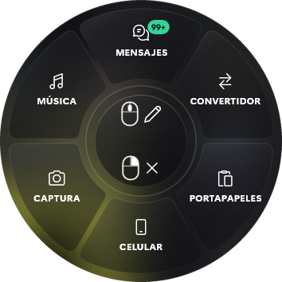

<h1 align="center">kyzWheel</h1>

Una rueda radial para Windows que abres con un atajo, desde cualquier programa. 
Mensajes de WhatsApp y Gmail, convertidor de archivos, portapapeles, tu celular, capturas y música.

<a href="https://github.com/yokyznt/kyzWheel/releases/latest"><b>⬇ Descargar para Windows</b></a> · <a href="docs/INSTALACION.md">Guía de instalación</a> · <a href="docs/USO.md">Cómo se usa</a> · <a href="docs/PROBLEMAS.md">Problemas comunes</a>

---

## Instalación rápida

1. Descarga **`kyzWheel-win-Setup.exe`** desde [la última versión](https://github.com/yokyznt/kyzWheel/releases/latest).
2. Ábrelo. Si Windows dice «Windows protegió tu PC», elige **Más información → Ejecutar de todas formas**. Sale porque el instalador no está firmado.
3. Listo. Aprieta **Ctrl + Shift + Alt** y suéltalas para abrir la rueda.

No necesita permisos de administrador, arranca solo con Windows y se actualiza solo. La guía completa, con Gmail, WhatsApp y el celular, está en **[docs/INSTALACION.md](docs/INSTALACION.md)**.

## Qué hace

| Sección | Para qué sirve |
|---|---|
| **Mensajes** | WhatsApp y Gmail junto a la rueda, en vivo. Puedes copiar texto, hacer capturas de mensajes y copiar códigos de verificación con un botón. |
| **Convertidor** | Imágenes, video, audio y PDF (unir, dividir, comprimir, pasar a imágenes, sacar el texto con OCR, pasar a Word) y quitar el fondo de fotos. Todo se procesa en tu PC. |
| **Portapapeles** | Historial de lo que copias, para pegarlo otra vez. También traduce entre español e inglés. |
| **Celular** | Manda archivos y el portapapeles a tu teléfono con KDE Connect. También lo hace sonar si no lo encuentras. |
| **Captura** | Recortar, copiar el texto de una parte de la pantalla, capturar la pantalla completa o grabar un clip. |
| **Música** | Pausa, siguiente, anterior y volumen de lo que esté sonando (Spotify, YouTube, etc.). |

Si tienes un **archivo seleccionado** y aprietas el atajo, la rueda abre con ese archivo en el centro: lo mandas por WhatsApp, lo conviertes o lo envías al celular en dos clics.

Los avisos de WhatsApp y correo salen arriba, con su propio estilo, aunque estés jugando en pantalla completa. Desde el aviso puedes contestar.

## Requisitos

- Windows 10 (versión 1809 o más nueva) o Windows 11, de 64 bits.
- Unos 450 MB libres.
- Para Gmail, una cuenta de Google. Para WhatsApp, tu teléfono con WhatsApp. Para la sección Celular, la app gratuita [KDE Connect](https://kdeconnect.kde.org/).

## Privacidad

Tus mensajes, correos y archivos no pasan por ningún servidor de kyzWheel. La app se conecta directo a Google, a WhatsApp y a tu celular, y guarda las contraseñas en el Administrador de credenciales de Windows. Detalle completo en [PRIVACY.md](PRIVACY.md).

La conexión con WhatsApp no es oficial: funciona como un «dispositivo vinculado», igual que WhatsApp Web. El riesgo de que WhatsApp restrinja la cuenta es bajo, pero existe.

## Para desarrolladores

Está hecho en C# (.NET 10 + WinUI 3), con un proceso en Node.js (Baileys) para WhatsApp. Cómo compilarlo: [docs/COMPILAR.md](docs/COMPILAR.md).

## English

kyzWheel is a radial launcher for Windows 10/11 (x64). Press **Ctrl + Shift + Alt** anywhere to open it. It includes live WhatsApp and Gmail, a local file converter, clipboard history, phone sync via KDE Connect, screen capture with OCR, and media controls. Download `kyzWheel-win-Setup.exe` from [Releases](https://github.com/yokyznt/kyzWheel/releases/latest). It installs per user and updates itself. The interface is in Spanish.

## Licencia

[MIT](LICENSE)
