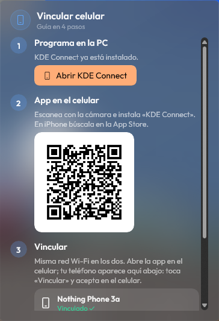

# Guía de instalación

Tarda unos 5 minutos. Los pasos 3 a 5 son opcionales: haz solo los de las secciones que vayas a usar.

## 1. Descargar e instalar

1. Entra a **[la última versión](https://github.com/yokyznt/kyzWheel/releases/latest)** y descarga **`kyzWheel-win-Setup.exe`**. Pesa unos 180 MB.
2. Ábrelo con doble clic.
3. Si sale **«Windows protegió tu PC»**, elige **Más información** y luego **Ejecutar de todas formas**. Aparece porque el instalador no tiene firma digital de pago, no porque tenga virus.
4. Se instala solo en unos segundos. No pide administrador y crea un acceso directo en el Escritorio y en el menú Inicio.

Al abrirse por primera vez sale el aviso **«kyzWheel está listo»** con el atajo.

> Si tu antivirus lo bloquea, agrega como excepción la carpeta `%LOCALAPPDATA%\kyzWheel`.

## 2. Abrir la rueda

- Aprieta **Ctrl + Shift + Alt** al mismo tiempo, en cualquier orden, y **suéltalas**. La rueda aparece donde está el mouse.
- Mueve el mouse hacia una sección y da **clic**.
- **Clic derecho** regresa o cierra la rueda. **Clic con la rueda del mouse** entra al modo para ordenar.

El atajo se cambia en **Ajustes** (ícono de kyzWheel junto al reloj → Ajustes → Atajo global).

## 3. Conectar Gmail (opcional)

1. Abre la rueda → **Mensajes** → **Conectar Gmail**.
2. Se abre tu navegador para elegir tu cuenta de Google.
3. Google mostrará **«Google no verificó esta app»**. Toca **Configuración avanzada** y luego **Ir a kyzWheel (no seguro)**.
   La app es nueva y todavía no pasa la revisión de Google, por eso sale el aviso. Puedes revisar su código en este repositorio.
4. Acepta los permisos. El navegador dice «Listo» y en kyzWheel aparece **«Gmail conectado»**.

Para agregar otra cuenta, usa el botón **+** del panel de Gmail.

**Otros correos** (Outlook, Yahoo, iCloud u otro con IMAP) se agregan en **Ajustes → Cuentas**, con una *contraseña de aplicación* de tu proveedor.

## 4. Vincular WhatsApp (opcional)

1. Abre la rueda → **Mensajes** → **WhatsApp** y toca **Generar código**. Aparece un QR.
2. En tu teléfono abre WhatsApp → **Configuración → Dispositivos vinculados → Vincular un dispositivo** y escanea el QR.

Funciona igual que WhatsApp Web: tu teléfono no necesita estar prendido todo el tiempo. Para desvincular, hazlo desde la misma pantalla de *Dispositivos vinculados* del teléfono.

## 5. Vincular tu celular (opcional)

La sección **Celular** usa **KDE Connect**, que es gratis y cifrado. Necesitas el celular y la PC conectados al mismo Wi-Fi.

1. Abre la rueda → **Celular**. Si no tienes KDE Connect en la PC, se abre una guía con el botón **Instalar en la PC**.
2. Escanea el **QR** con la cámara del celular e instala **KDE Connect** desde la Play Store. En iPhone búscala en la App Store.
3. Abre la app en el celular. Tu teléfono aparece en la guía de kyzWheel: toca **Vincular** y acepta en el celular.
4. En el celular, entra a **KDE Connect → tu PC** y activa **Portapapeles**, **Compartir** y **Notificaciones**.
5. Toca **Probar conexión**: te llega un aviso al teléfono.

La guía se vuelve a abrir cuando quieras desde **Celular → Vincular**.

 

## 6. Personalizar

En **Ajustes** cambias:

- **Tema:** 12 estilos, cada uno con su forma y su tipo de letra.
- **Notificaciones:** en qué pantalla y en qué esquina salen los avisos. Al cambiarlo sale uno de prueba.
- **Secciones:** cuáles salen en la rueda y en qué orden.
- **Opciones de cada sección:** qué sale dentro de Celular, Captura, Música y Mensajes, y en qué orden.
- **Iniciar con Windows.**

## Actualizaciones

kyzWheel busca versiones nuevas al iniciar y cada 3 horas. Cuando hay una, sale el aviso **«Nueva versión · toca para instalar»**. Si no lo tocas, se instala sola la próxima vez que se reinicie.

## Desinstalar

**Configuración de Windows → Aplicaciones → Aplicaciones instaladas → kyzWheel → Desinstalar.**

Tu configuración se queda en `%APPDATA%\kyzWheel` y los datos en `%LOCALAPPDATA%\kyzWheel.Data`. Borra esas dos carpetas si no vas a volver a usarlo. Las contraseñas guardadas están en el *Administrador de credenciales* de Windows, con nombres que empiezan con `kyzWheel:`.

¿Algo no funciona? Revisa **[PROBLEMAS.md](PROBLEMAS.md)**.
